# Галерея Reelaris

Все 295 превью из Awesome Claude Video Skills. GIF сохранены анимированными, исходные файлы лежат в репозитории. Нажатие на картинку открывает проект автора. [Назад к инструменту](README.md) · [Авторы и лицензии](reelaris/upstream/awesome-claude-video-skills/assets/previews/NOTICE.md)

## Фреймворки и инструменты

<table>
<tr>
<td width="33%" align="center" valign="top"><a href="https://github.com/8533502-dev/deepseek-opus-motion-skill">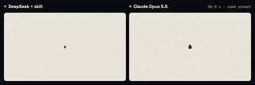</a> <a href="https://github.com/8533502-dev/deepseek-opus-motion-skill">8533502-dev/deepseek-opus-motion-skill</a> GIF · MIT</td>
<td width="33%" align="center" valign="top"><a href="https://github.com/8533502-dev/deepseek-opus-motion-skill">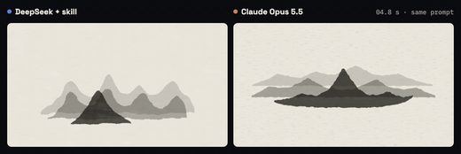</a> <a href="https://github.com/8533502-dev/deepseek-opus-motion-skill">8533502-dev/deepseek-opus-motion-skill</a> JPG · MIT</td>
<td width="33%" align="center" valign="top"><a href="https://github.com/AIPMAndy/Andy-Video-Skill">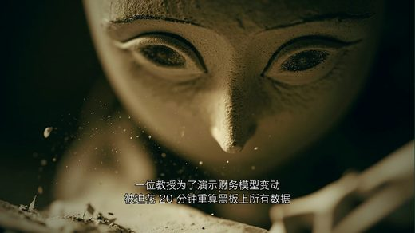</a> <a href="https://github.com/AIPMAndy/Andy-Video-Skill">AIPMAndy/Andy-Video-Skill</a> JPG · MIT</td>
</tr>
<tr>
<td width="33%" align="center" valign="top"><a href="https://github.com/Aaryan-Kapoor/video-production-skill">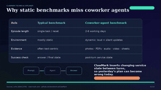</a> <a href="https://github.com/Aaryan-Kapoor/video-production-skill">Aaryan-Kapoor/video-production-skill</a> GIF · MIT</td>
<td width="33%" align="center" valign="top"><a href="https://github.com/Aaryan-Kapoor/video-production-skill">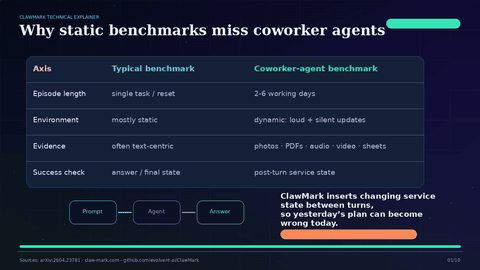</a> <a href="https://github.com/Aaryan-Kapoor/video-production-skill">Aaryan-Kapoor/video-production-skill</a> JPG · MIT</td>
<td width="33%" align="center" valign="top"><a href="https://github.com/AnmolChandiok/claude-after-effects-skill">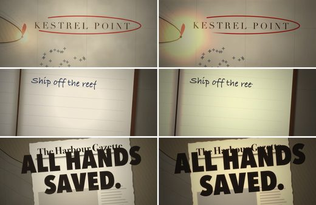</a> <a href="https://github.com/AnmolChandiok/claude-after-effects-skill">AnmolChandiok/claude-after-effects-skill</a> JPG · MIT</td>
</tr>
<tr>
<td width="33%" align="center" valign="top"><a href="https://github.com/Changroro/code-video">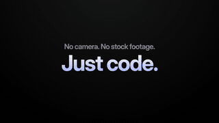</a> <a href="https://github.com/Changroro/code-video">Changroro/code-video</a> GIF · MIT</td>
<td width="33%" align="center" valign="top"> <a href="https://github.com/Changroro/code-video">Changroro/code-video</a> JPG · MIT</td>
<td width="33%" align="center" valign="top"><a href="https://github.com/FavioVazquez/showtime">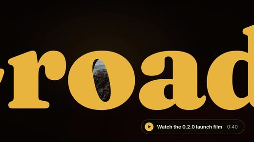</a> <a href="https://github.com/FavioVazquez/showtime">FavioVazquez/showtime</a> JPG · MIT</td>
</tr>
<tr>
<td width="33%" align="center" valign="top"> <a href="https://github.com/Johnson-Jia/video-clipforge">Johnson-Jia/video-clipforge</a> JPG · Apache-2.0</td>
<td width="33%" align="center" valign="top"><a href="https://github.com/Kimeur/motion-launch-videos">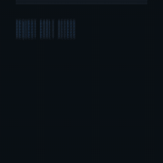</a> <a href="https://github.com/Kimeur/motion-launch-videos">Kimeur/motion-launch-videos</a> GIF · MIT</td>
<td width="33%" align="center" valign="top"> <a href="https://github.com/Kimeur/motion-launch-videos">Kimeur/motion-launch-videos</a> JPG · MIT</td>
</tr>
<tr>
<td width="33%" align="center" valign="top"><a href="https://github.com/LordVayron/video-factory">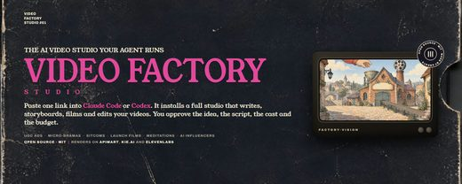</a> <a href="https://github.com/LordVayron/video-factory">LordVayron/video-factory</a> JPG · MIT</td>
<td width="33%" align="center" valign="top"> <a href="https://github.com/MakeMyClip/editor">MakeMyClip/editor</a> JPG · MIT</td>
<td width="33%" align="center" valign="top"><a href="https://github.com/Moessif/code-video-showcase">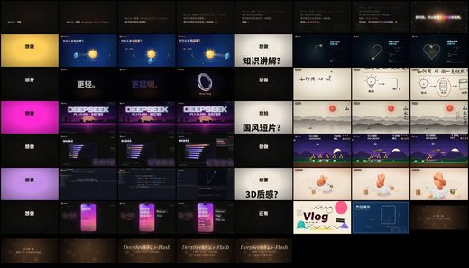</a> <a href="https://github.com/Moessif/code-video-showcase">Moessif/code-video-showcase</a> JPG · MIT</td>
</tr>
<tr>
<td width="33%" align="center" valign="top"><a href="https://github.com/Neelshah1810/Claude-Video-Skills">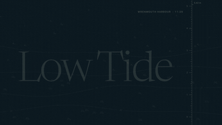</a> <a href="https://github.com/Neelshah1810/Claude-Video-Skills">Neelshah1810/Claude-Video-Skills</a> GIF · MIT</td>
<td width="33%" align="center" valign="top"><a href="https://github.com/Neelshah1810/Claude-Video-Skills">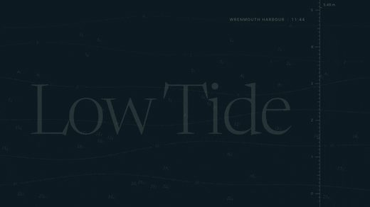</a> <a href="https://github.com/Neelshah1810/Claude-Video-Skills">Neelshah1810/Claude-Video-Skills</a> JPG · MIT</td>
<td width="33%" align="center" valign="top"><a href="https://github.com/PHANTOMTONYT/motion-design-skills">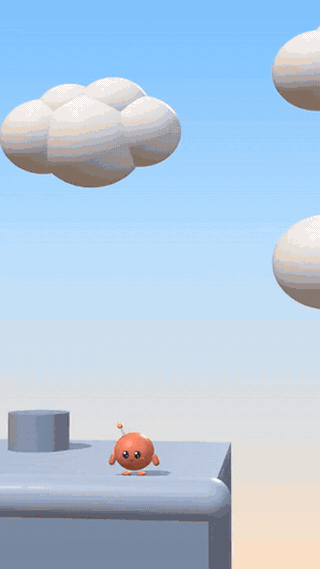</a> <a href="https://github.com/PHANTOMTONYT/motion-design-skills">PHANTOMTONYT/motion-design-skills</a> GIF · MIT</td>
</tr>
<tr>
<td width="33%" align="center" valign="top"><a href="https://github.com/PHANTOMTONYT/motion-design-skills">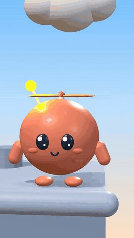</a> <a href="https://github.com/PHANTOMTONYT/motion-design-skills">PHANTOMTONYT/motion-design-skills</a> JPG · MIT</td>
<td width="33%" align="center" valign="top"><a href="https://github.com/Shugar86/vids-studio">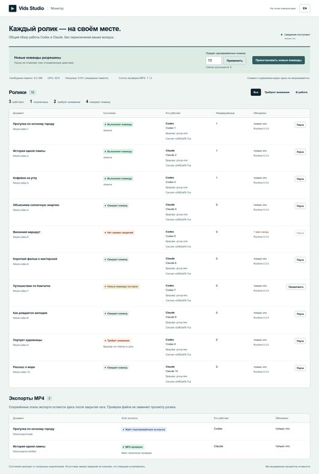</a> <a href="https://github.com/Shugar86/vids-studio">Shugar86/vids-studio</a> JPG · MIT</td>
<td width="33%" align="center" valign="top"><a href="https://github.com/WhiteTowerAI/cut-as-code">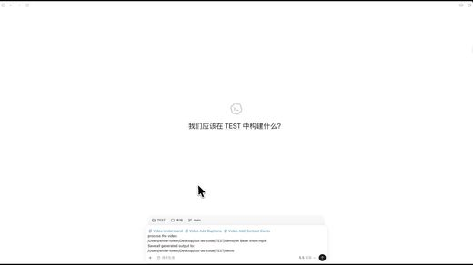</a> <a href="https://github.com/WhiteTowerAI/cut-as-code">WhiteTowerAI/cut-as-code</a> JPG · MIT</td>
</tr>
<tr>
<td width="33%" align="center" valign="top"><a href="https://github.com/ZLHad/OpenVideoHarness">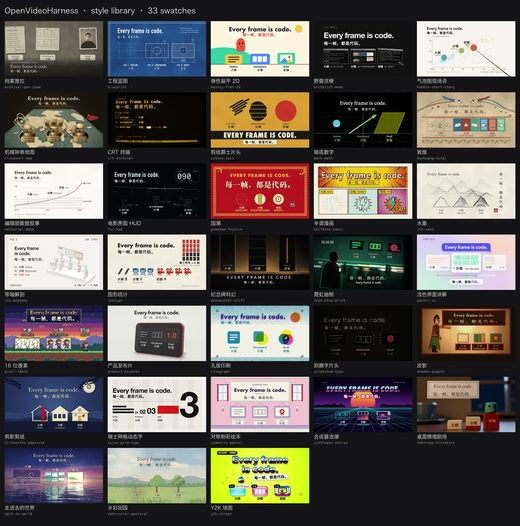</a> <a href="https://github.com/ZLHad/OpenVideoHarness">ZLHad/OpenVideoHarness</a> JPG · MIT</td>
<td width="33%" align="center" valign="top"><a href="https://github.com/actionow-ai/vvv">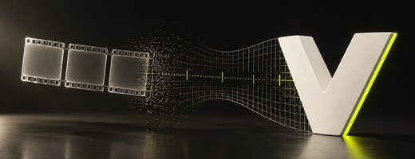</a> <a href="https://github.com/actionow-ai/vvv">actionow-ai/vvv</a> JPG · MIT</td>
<td width="33%" align="center" valign="top"> <a href="https://github.com/autoip/dreamfab">autoip/dreamfab</a> JPG · MIT</td>
</tr>
<tr>
<td width="33%" align="center" valign="top"> <a href="https://github.com/bangtutorial/bang-motion">bangtutorial/bang-motion</a> JPG · MIT</td>
<td width="33%" align="center" valign="top"> <a href="https://github.com/bbylw/hyperframes-cn">bbylw/hyperframes-cn</a> JPG · MIT</td>
<td width="33%" align="center" valign="top"><a href="https://github.com/chrisopal/narrated-video-studio">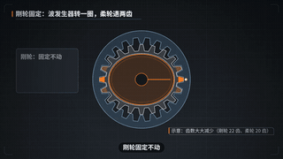</a> <a href="https://github.com/chrisopal/narrated-video-studio">chrisopal/narrated-video-studio</a> GIF · MIT</td>
</tr>
<tr>
<td width="33%" align="center" valign="top"><a href="https://github.com/chrisopal/narrated-video-studio">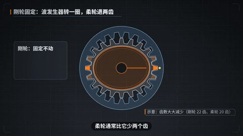</a> <a href="https://github.com/chrisopal/narrated-video-studio">chrisopal/narrated-video-studio</a> JPG · MIT</td>
<td width="33%" align="center" valign="top"><a href="https://github.com/crawfordxx/xiaoma-studio">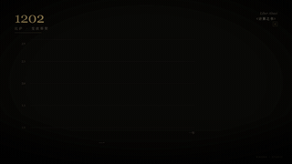</a> <a href="https://github.com/crawfordxx/xiaoma-studio">crawfordxx/xiaoma-studio</a> GIF · MIT</td>
<td width="33%" align="center" valign="top"><a href="https://github.com/crawfordxx/xiaoma-studio">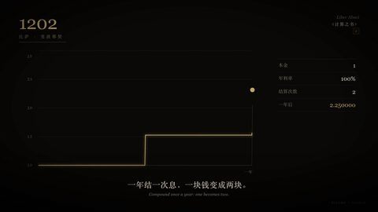</a> <a href="https://github.com/crawfordxx/xiaoma-studio">crawfordxx/xiaoma-studio</a> JPG · MIT</td>
</tr>
<tr>
<td width="33%" align="center" valign="top"> <a href="https://github.com/davidcervinka/vibe-editing">davidcervinka/vibe-editing</a> GIF · MIT</td>
<td width="33%" align="center" valign="top"> <a href="https://github.com/davidcervinka/vibe-editing">davidcervinka/vibe-editing</a> JPG · MIT</td>
<td width="33%" align="center" valign="top"><a href="https://github.com/digitalsamba/claude-code-video-toolkit">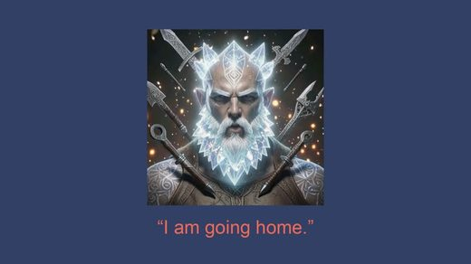</a> <a href="https://github.com/digitalsamba/claude-code-video-toolkit">digitalsamba/claude-code-video-toolkit</a> JPG · MIT</td>
</tr>
<tr>
<td width="33%" align="center" valign="top"> <a href="https://github.com/edotheDev/claude-video-kit">edotheDev/claude-video-kit</a> JPG · MIT</td>
<td width="33%" align="center" valign="top"> <a href="https://github.com/erduo1998-cell/vidmuse-video-creator">erduo1998-cell/vidmuse-video-creator</a> JPG · MIT</td>
<td width="33%" align="center" valign="top"><a href="https://github.com/heygen-com/hyperframes">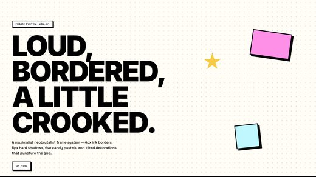</a> <a href="https://github.com/heygen-com/hyperframes">heygen-com/hyperframes</a> JPG · Apache-2.0</td>
</tr>
<tr>
<td width="33%" align="center" valign="top"><a href="https://github.com/hildlabs/openrig-studio">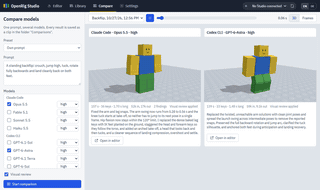</a> <a href="https://github.com/hildlabs/openrig-studio">hildlabs/openrig-studio</a> GIF · MIT</td>
<td width="33%" align="center" valign="top"><a href="https://github.com/hildlabs/openrig-studio">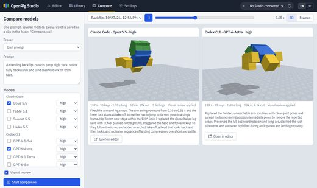</a> <a href="https://github.com/hildlabs/openrig-studio">hildlabs/openrig-studio</a> JPG · MIT</td>
<td width="33%" align="center" valign="top"><a href="https://github.com/hraness/slopcamera">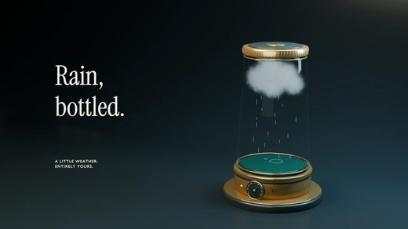</a> <a href="https://github.com/hraness/slopcamera">hraness/slopcamera</a> JPG · MIT</td>
</tr>
<tr>
<td width="33%" align="center" valign="top"><a href="https://github.com/iart-ai/data-animation-skills">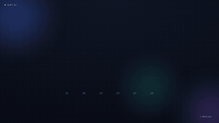</a> <a href="https://github.com/iart-ai/data-animation-skills">iart-ai/data-animation-skills</a> GIF · MIT</td>
<td width="33%" align="center" valign="top"><a href="https://github.com/iart-ai/data-animation-skills">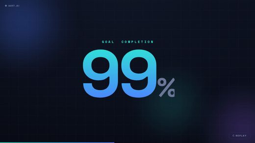</a> <a href="https://github.com/iart-ai/data-animation-skills">iart-ai/data-animation-skills</a> JPG · MIT</td>
<td width="33%" align="center" valign="top"> <a href="https://github.com/iart-ai/motion-design-skills">iart-ai/motion-design-skills</a> GIF · MIT</td>
</tr>
<tr>
<td width="33%" align="center" valign="top"><a href="https://github.com/iart-ai/motion-design-skills">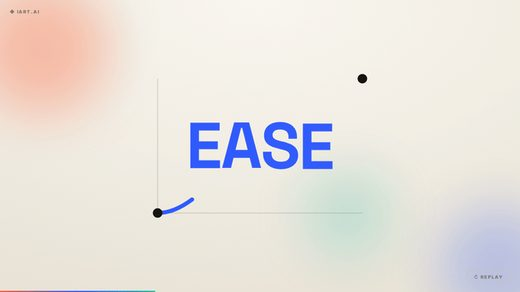</a> <a href="https://github.com/iart-ai/motion-design-skills">iart-ai/motion-design-skills</a> JPG · MIT</td>
<td width="33%" align="center" valign="top"><a href="https://github.com/iart-ai/motion-skills">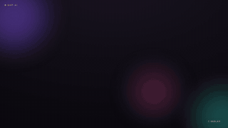</a> <a href="https://github.com/iart-ai/motion-skills">iart-ai/motion-skills</a> GIF · MIT</td>
<td width="33%" align="center" valign="top"><a href="https://github.com/iart-ai/motion-skills">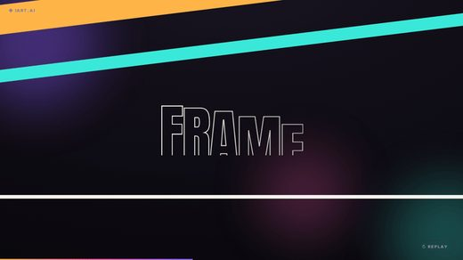</a> <a href="https://github.com/iart-ai/motion-skills">iart-ai/motion-skills</a> JPG · MIT</td>
</tr>
<tr>
<td width="33%" align="center" valign="top"> <a href="https://github.com/iart-ai/text-message-video-skills">iart-ai/text-message-video-skills</a> GIF · MIT</td>
<td width="33%" align="center" valign="top"><a href="https://github.com/iart-ai/text-message-video-skills">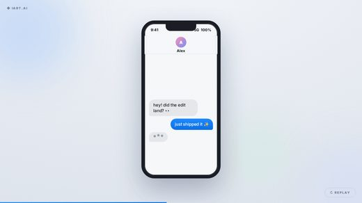</a> <a href="https://github.com/iart-ai/text-message-video-skills">iart-ai/text-message-video-skills</a> JPG · MIT</td>
<td width="33%" align="center" valign="top"> <a href="https://github.com/liaojianquan9-source/ljq-broll-video-generator">liaojianquan9-source/ljq-broll-video-generator</a> GIF · MIT</td>
</tr>
<tr>
<td width="33%" align="center" valign="top"><a href="https://github.com/liaojianquan9-source/ljq-broll-video-generator">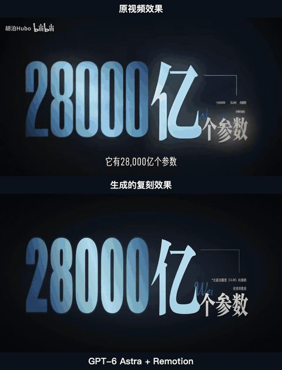</a> <a href="https://github.com/liaojianquan9-source/ljq-broll-video-generator">liaojianquan9-source/ljq-broll-video-generator</a> JPG · MIT</td>
<td width="33%" align="center" valign="top"><a href="https://github.com/magichourhq/skills">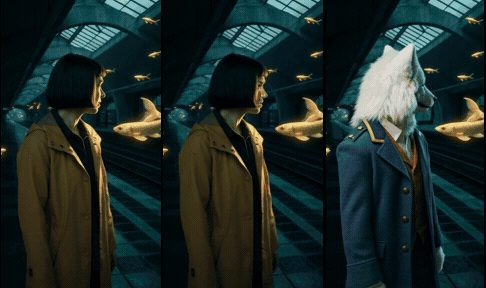</a> <a href="https://github.com/magichourhq/skills">magichourhq/skills</a> JPG · MIT</td>
<td width="33%" align="center" valign="top"><a href="https://github.com/motalim-ai/motion-starter-kit">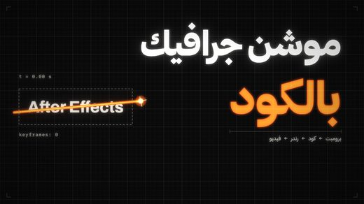</a> <a href="https://github.com/motalim-ai/motion-starter-kit">motalim-ai/motion-starter-kit</a> JPG · MIT</td>
</tr>
<tr>
<td width="33%" align="center" valign="top"><a href="https://github.com/oxygenframe/oxframe-sdk">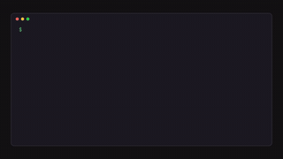</a> <a href="https://github.com/oxygenframe/oxframe-sdk">oxygenframe/oxframe-sdk</a> GIF · Apache-2.0</td>
<td width="33%" align="center" valign="top"><a href="https://github.com/oxygenframe/oxframe-sdk">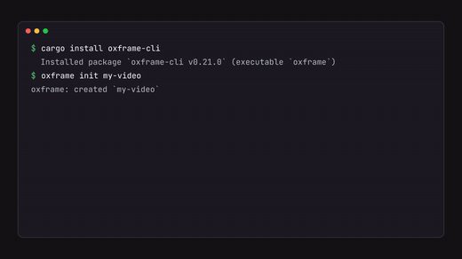</a> <a href="https://github.com/oxygenframe/oxframe-sdk">oxygenframe/oxframe-sdk</a> JPG · Apache-2.0</td>
<td width="33%" align="center" valign="top"> <a href="https://github.com/smwbev/framewright">smwbev/framewright</a> JPG · MIT</td>
</tr>
<tr>
<td width="33%" align="center" valign="top"> <a href="https://github.com/vawe-hq/vawe">vawe-hq/vawe</a> GIF · Apache-2.0</td>
<td width="33%" align="center" valign="top"><a href="https://github.com/vawe-hq/vawe">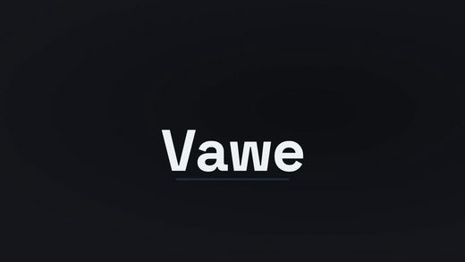</a> <a href="https://github.com/vawe-hq/vawe">vawe-hq/vawe</a> JPG · Apache-2.0</td>
<td width="33%" align="center" valign="top"><a href="https://github.com/video-db/skills">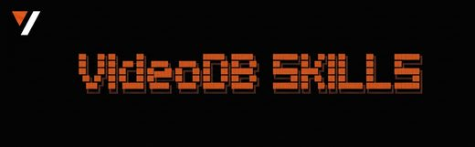</a> <a href="https://github.com/video-db/skills">video-db/skills</a> JPG · MIT</td>
</tr>
<tr>
<td width="33%" align="center" valign="top"><a href="https://github.com/zhouyuechuan2025-ui/ai-self-media-video-packaging-skill">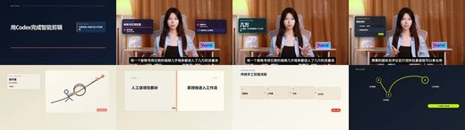</a> <a href="https://github.com/zhouyuechuan2025-ui/ai-self-media-video-packaging-skill">zhouyuechuan2025-ui/ai-self-media-video-packaging-skill</a> JPG · MIT</td>
</tr>
</table>

## Промо и демонстрации

<table>
<tr>
<td width="33%" align="center" valign="top"><a href="https://github.com/AbubakrChan/product-launch-motion">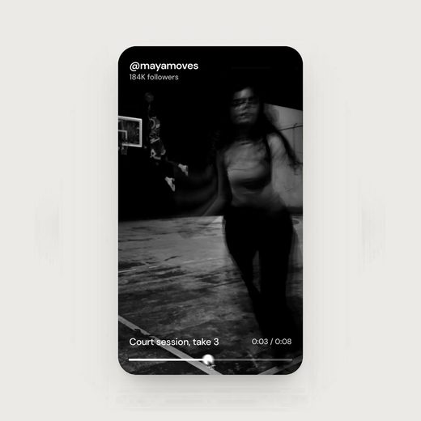</a> <a href="https://github.com/AbubakrChan/product-launch-motion">AbubakrChan/product-launch-motion</a> JPG · MIT</td>
<td width="33%" align="center" valign="top"><a href="https://github.com/AlexAnsart/demo-studio">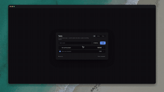</a> <a href="https://github.com/AlexAnsart/demo-studio">AlexAnsart/demo-studio</a> GIF · MIT</td>
<td width="33%" align="center" valign="top"><a href="https://github.com/AlexAnsart/demo-studio">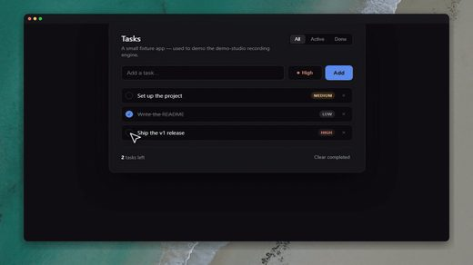</a> <a href="https://github.com/AlexAnsart/demo-studio">AlexAnsart/demo-studio</a> JPG · MIT</td>
</tr>
<tr>
<td width="33%" align="center" valign="top"> <a href="https://github.com/AmazingAng/ccvideo">AmazingAng/ccvideo</a> GIF · MIT</td>
<td width="33%" align="center" valign="top"><a href="https://github.com/AmazingAng/ccvideo">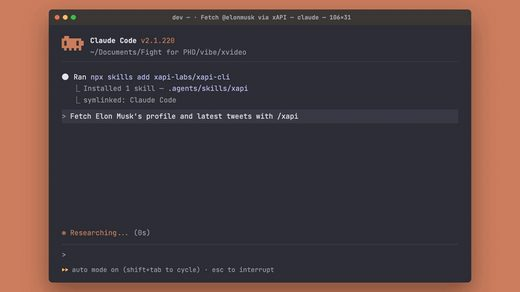</a> <a href="https://github.com/AmazingAng/ccvideo">AmazingAng/ccvideo</a> JPG · MIT</td>
<td width="33%" align="center" valign="top"><a href="https://github.com/AmirSbss/spotlight">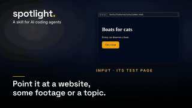</a> <a href="https://github.com/AmirSbss/spotlight">AmirSbss/spotlight</a> GIF · MIT</td>
</tr>
<tr>
<td width="33%" align="center" valign="top"><a href="https://github.com/AmirSbss/spotlight">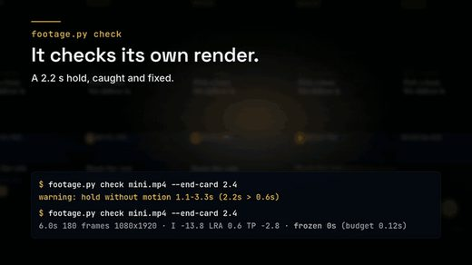</a> <a href="https://github.com/AmirSbss/spotlight">AmirSbss/spotlight</a> JPG · MIT</td>
<td width="33%" align="center" valign="top"> <a href="https://github.com/Arman-Luthra/aftr">Arman-Luthra/aftr</a> GIF · MIT</td>
<td width="33%" align="center" valign="top"><a href="https://github.com/Arman-Luthra/aftr">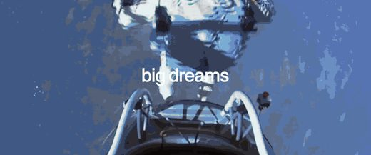</a> <a href="https://github.com/Arman-Luthra/aftr">Arman-Luthra/aftr</a> JPG · MIT</td>
</tr>
<tr>
<td width="33%" align="center" valign="top"> <a href="https://github.com/Finderchangchang/promo-video-skill">Finderchangchang/promo-video-skill</a> JPG · Apache-2.0</td>
<td width="33%" align="center" valign="top"> <a href="https://github.com/Hainrixz/motion-architect">Hainrixz/motion-architect</a> GIF · MIT</td>
<td width="33%" align="center" valign="top"><a href="https://github.com/Hainrixz/motion-architect">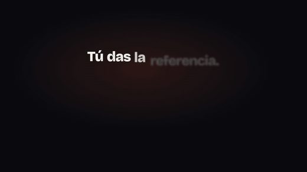</a> <a href="https://github.com/Hainrixz/motion-architect">Hainrixz/motion-architect</a> JPG · MIT</td>
</tr>
<tr>
<td width="33%" align="center" valign="top"> <a href="https://github.com/IskakovDamir/apple-motion">IskakovDamir/apple-motion</a> GIF · MIT</td>
<td width="33%" align="center" valign="top"> <a href="https://github.com/IskakovDamir/apple-motion">IskakovDamir/apple-motion</a> JPG · MIT</td>
<td width="33%" align="center" valign="top"> <a href="https://github.com/JohnChow90/video-shotcraft">JohnChow90/video-shotcraft</a> JPG · Apache-2.0</td>
</tr>
<tr>
<td width="33%" align="center" valign="top"> <a href="https://github.com/Kianzzz/xilo-opus-video">Kianzzz/xilo-opus-video</a> JPG · MIT</td>
<td width="33%" align="center" valign="top"> <a href="https://github.com/SallyRS/video-director">SallyRS/video-director</a> GIF · MIT</td>
<td width="33%" align="center" valign="top"> <a href="https://github.com/SallyRS/video-director">SallyRS/video-director</a> JPG · MIT</td>
</tr>
<tr>
<td width="33%" align="center" valign="top"> <a href="https://github.com/Tejashmakwana/motionmaxxing">Tejashmakwana/motionmaxxing</a> GIF · Apache-2.0</td>
<td width="33%" align="center" valign="top"> <a href="https://github.com/Tejashmakwana/motionmaxxing">Tejashmakwana/motionmaxxing</a> JPG · Apache-2.0</td>
<td width="33%" align="center" valign="top"> <a href="https://github.com/YahyaLendani/motionbrief-claude-skills">YahyaLendani/motionbrief-claude-skills</a> GIF · MIT</td>
</tr>
<tr>
<td width="33%" align="center" valign="top"> <a href="https://github.com/YahyaLendani/motionbrief-claude-skills">YahyaLendani/motionbrief-claude-skills</a> JPG · MIT</td>
<td width="33%" align="center" valign="top"> <a href="https://github.com/Zane-0x5a/remotion-director">Zane-0x5a/remotion-director</a> JPG · MIT</td>
<td width="33%" align="center" valign="top"> <a href="https://github.com/aaitor/skill-video-studio">aaitor/skill-video-studio</a> GIF · MIT</td>
</tr>
<tr>
<td width="33%" align="center" valign="top"> <a href="https://github.com/aaitor/skill-video-studio">aaitor/skill-video-studio</a> JPG · MIT</td>
<td width="33%" align="center" valign="top"> <a href="https://github.com/axtonliu/video-illustrator">axtonliu/video-illustrator</a> JPG · MIT</td>
<td width="33%" align="center" valign="top"> <a href="https://github.com/charlie947/motion-graphics-skills">charlie947/motion-graphics-skills</a> GIF · MIT</td>
</tr>
<tr>
<td width="33%" align="center" valign="top"> <a href="https://github.com/charlie947/motion-graphics-skills">charlie947/motion-graphics-skills</a> JPG · MIT</td>
<td width="33%" align="center" valign="top"> <a href="https://github.com/crimeacs/product-demo-director">crimeacs/product-demo-director</a> GIF · MIT</td>
<td width="33%" align="center" valign="top"> <a href="https://github.com/crimeacs/product-demo-director">crimeacs/product-demo-director</a> JPG · MIT</td>
</tr>
<tr>
<td width="33%" align="center" valign="top"> <a href="https://github.com/dauletbekalim/motion-ui-videos">dauletbekalim/motion-ui-videos</a> GIF · MIT</td>
<td width="33%" align="center" valign="top"> <a href="https://github.com/dauletbekalim/motion-ui-videos">dauletbekalim/motion-ui-videos</a> JPG · MIT</td>
<td width="33%" align="center" valign="top"> <a href="https://github.com/david-d2c2/motion-promo-reels">david-d2c2/motion-promo-reels</a> GIF · MIT</td>
</tr>
<tr>
<td width="33%" align="center" valign="top"> <a href="https://github.com/david-d2c2/motion-promo-reels">david-d2c2/motion-promo-reels</a> JPG · MIT</td>
<td width="33%" align="center" valign="top"> <a href="https://github.com/echoD886/dramacanvas-ai-filmmaking-mcp">echoD886/dramacanvas-ai-filmmaking-mcp</a> JPG · MIT</td>
<td width="33%" align="center" valign="top"> <a href="https://github.com/gmpetrov/agent-screenplay">gmpetrov/agent-screenplay</a> JPG · MIT</td>
</tr>
<tr>
<td width="33%" align="center" valign="top"> <a href="https://github.com/howseen-ai/claude-motion-design">howseen-ai/claude-motion-design</a> GIF · MIT</td>
<td width="33%" align="center" valign="top"> <a href="https://github.com/howseen-ai/claude-motion-design">howseen-ai/claude-motion-design</a> JPG · MIT</td>
<td width="33%" align="center" valign="top"> <a href="https://github.com/hub-ki/video-generation">hub-ki/video-generation</a> GIF · MIT</td>
</tr>
<tr>
<td width="33%" align="center" valign="top"> <a href="https://github.com/hub-ki/video-generation">hub-ki/video-generation</a> JPG · MIT</td>
<td width="33%" align="center" valign="top"> <a href="https://github.com/iart-ai/ad-video-skills">iart-ai/ad-video-skills</a> GIF · MIT</td>
<td width="33%" align="center" valign="top"> <a href="https://github.com/iart-ai/ad-video-skills">iart-ai/ad-video-skills</a> JPG · MIT</td>
</tr>
<tr>
<td width="33%" align="center" valign="top"> <a href="https://github.com/jammaru/launch-video-craft">jammaru/launch-video-craft</a> JPG · MIT</td>
<td width="33%" align="center" valign="top"> <a href="https://github.com/krisyangdev/motionboard">krisyangdev/motionboard</a> GIF · MIT</td>
<td width="33%" align="center" valign="top"> <a href="https://github.com/krisyangdev/motionboard">krisyangdev/motionboard</a> JPG · MIT</td>
</tr>
<tr>
<td width="33%" align="center" valign="top"> <a href="https://github.com/mad-helpers/motion-harness">mad-helpers/motion-harness</a> JPG · MIT</td>
<td width="33%" align="center" valign="top"> <a href="https://github.com/memex-lab/product-launch-video-skill">memex-lab/product-launch-video-skill</a> JPG · MIT</td>
<td width="33%" align="center" valign="top"> <a href="https://github.com/mrieck/demoday-claude-plugin">mrieck/demoday-claude-plugin</a> JPG · MIT</td>
</tr>
<tr>
<td width="33%" align="center" valign="top"> <a href="https://github.com/murathany7/reel-studio">murathany7/reel-studio</a> JPG · MIT</td>
<td width="33%" align="center" valign="top"> <a href="https://github.com/new-xp/ultrademo">new-xp/ultrademo</a> GIF · Apache-2.0</td>
<td width="33%" align="center" valign="top"> <a href="https://github.com/new-xp/ultrademo">new-xp/ultrademo</a> JPG · Apache-2.0</td>
</tr>
<tr>
<td width="33%" align="center" valign="top"> <a href="https://github.com/noamdorr/saas-product-demo-video">noamdorr/saas-product-demo-video</a> JPG · MIT</td>
<td width="33%" align="center" valign="top"> <a href="https://github.com/patryk-penczek/ship-video">patryk-penczek/ship-video</a> JPG · MIT</td>
<td width="33%" align="center" valign="top"> <a href="https://github.com/precious112/demo-director">precious112/demo-director</a> GIF · MIT</td>
</tr>
<tr>
<td width="33%" align="center" valign="top"> <a href="https://github.com/precious112/demo-director">precious112/demo-director</a> JPG · MIT</td>
<td width="33%" align="center" valign="top"> <a href="https://github.com/revfactory/showreel">revfactory/showreel</a> GIF · MIT</td>
<td width="33%" align="center" valign="top"> <a href="https://github.com/revfactory/showreel">revfactory/showreel</a> JPG · MIT</td>
</tr>
<tr>
<td width="33%" align="center" valign="top"> <a href="https://github.com/rjmahesh/ui-redline-walkthrough">rjmahesh/ui-redline-walkthrough</a> JPG · MIT</td>
<td width="33%" align="center" valign="top"> <a href="https://github.com/samuelstroschein/opus-video-generator">samuelstroschein/opus-video-generator</a> JPG · MIT</td>
<td width="33%" align="center" valign="top"> <a href="https://github.com/smit-vanani/claude-promo-video">smit-vanani/claude-promo-video</a> JPG · MIT</td>
</tr>
<tr>
<td width="33%" align="center" valign="top"> <a href="https://github.com/sub-level/marketing-videos">sub-level/marketing-videos</a> JPG · MIT</td>
<td width="33%" align="center" valign="top"> <a href="https://github.com/surajshetty3416/demo-video-skill">surajshetty3416/demo-video-skill</a> JPG · MIT</td>
<td width="33%" align="center" valign="top"> <a href="https://github.com/timscheuerai/launch-video-kit">timscheuerai/launch-video-kit</a> GIF · MIT</td>
</tr>
<tr>
<td width="33%" align="center" valign="top"> <a href="https://github.com/timscheuerai/launch-video-kit">timscheuerai/launch-video-kit</a> JPG · MIT</td>
<td width="33%" align="center" valign="top"> <a href="https://github.com/trunghaiy/appshot">trunghaiy/appshot</a> GIF · MIT</td>
<td width="33%" align="center" valign="top"> <a href="https://github.com/trunghaiy/appshot">trunghaiy/appshot</a> JPG · MIT</td>
</tr>
<tr>
<td width="33%" align="center" valign="top"> <a href="https://github.com/y-wi/horizon-montage-generic">y-wi/horizon-montage-generic</a> JPG · MIT</td>
</tr>
</table>

## Объясняющие видео

<table>
<tr>
<td width="33%" align="center" valign="top"> <a href="https://github.com/124zhe/xigua-msvideo-skill">124zhe/xigua-msvideo-skill</a> JPG · MIT</td>
<td width="33%" align="center" valign="top"> <a href="https://github.com/Acorn2/frame-loom">Acorn2/frame-loom</a> GIF · MIT</td>
<td width="33%" align="center" valign="top"> <a href="https://github.com/Acorn2/frame-loom">Acorn2/frame-loom</a> JPG · MIT</td>
</tr>
<tr>
<td width="33%" align="center" valign="top"> <a href="https://github.com/Agentchengfeng/chengfeng-video-styles">Agentchengfeng/chengfeng-video-styles</a> JPG · Apache-2.0</td>
<td width="33%" align="center" valign="top"> <a href="https://github.com/Alisa0808/vox-director">Alisa0808/vox-director</a> JPG · MIT</td>
<td width="33%" align="center" valign="top"> <a href="https://github.com/AmitSubhash/3brown1blue">AmitSubhash/3brown1blue</a> GIF · MIT</td>
</tr>
<tr>
<td width="33%" align="center" valign="top"> <a href="https://github.com/AmitSubhash/3brown1blue">AmitSubhash/3brown1blue</a> JPG · MIT</td>
<td width="33%" align="center" valign="top"> <a href="https://github.com/Lunamos/paper2video">Lunamos/paper2video</a> JPG · MIT</td>
<td width="33%" align="center" valign="top"> <a href="https://github.com/Matteoikarieth96/whiteboard-video-skill">Matteoikarieth96/whiteboard-video-skill</a> GIF · MIT</td>
</tr>
<tr>
<td width="33%" align="center" valign="top"> <a href="https://github.com/Matteoikarieth96/whiteboard-video-skill">Matteoikarieth96/whiteboard-video-skill</a> JPG · MIT</td>
<td width="33%" align="center" valign="top"> <a href="https://github.com/Moh4696/cinematic-skill">Moh4696/cinematic-skill</a> JPG · MIT</td>
<td width="33%" align="center" valign="top"> <a href="https://github.com/Nealsun1993/talk-workbench">Nealsun1993/talk-workbench</a> JPG · MIT</td>
</tr>
<tr>
<td width="33%" align="center" valign="top"> <a href="https://github.com/RohanRatwani/explainer-video-opus-5.5">RohanRatwani/explainer-video-opus-5.5</a> GIF · MIT</td>
<td width="33%" align="center" valign="top"> <a href="https://github.com/RohanRatwani/explainer-video-opus-5.5">RohanRatwani/explainer-video-opus-5.5</a> JPG · MIT</td>
<td width="33%" align="center" valign="top"> <a href="https://github.com/SunandBean/paper2video">SunandBean/paper2video</a> GIF · MIT</td>
</tr>
<tr>
<td width="33%" align="center" valign="top"> <a href="https://github.com/SunandBean/paper2video">SunandBean/paper2video</a> JPG · MIT</td>
<td width="33%" align="center" valign="top"> <a href="https://github.com/ahmdd4vd/MotionCraft">ahmdd4vd/MotionCraft</a> GIF · MIT</td>
<td width="33%" align="center" valign="top"> <a href="https://github.com/ahmdd4vd/MotionCraft">ahmdd4vd/MotionCraft</a> JPG · MIT</td>
</tr>
<tr>
<td width="33%" align="center" valign="top"> <a href="https://github.com/beriki770-ship-it/code-animations">beriki770-ship-it/code-animations</a> JPG · MIT</td>
<td width="33%" align="center" valign="top"> <a href="https://github.com/chenyuxiaojin/cyxj-hyperframes">chenyuxiaojin/cyxj-hyperframes</a> JPG · MIT</td>
<td width="33%" align="center" valign="top"> <a href="https://github.com/crawfordxx/paper-cut-video-skill">crawfordxx/paper-cut-video-skill</a> JPG · MIT</td>
</tr>
<tr>
<td width="33%" align="center" valign="top"> <a href="https://github.com/cymcymcymcym/notes-to-video">cymcymcymcym/notes-to-video</a> GIF · MIT</td>
<td width="33%" align="center" valign="top"> <a href="https://github.com/cymcymcymcym/notes-to-video">cymcymcymcym/notes-to-video</a> JPG · MIT</td>
<td width="33%" align="center" valign="top"> <a href="https://github.com/ekomen77/erko-ai-video-engine">ekomen77/erko-ai-video-engine</a> GIF · MIT</td>
</tr>
<tr>
<td width="33%" align="center" valign="top"> <a href="https://github.com/ekomen77/erko-ai-video-engine">ekomen77/erko-ai-video-engine</a> JPG · MIT</td>
<td width="33%" align="center" valign="top"> <a href="https://github.com/fltman/infofilm">fltman/infofilm</a> JPG · MIT</td>
<td width="33%" align="center" valign="top"> <a href="https://github.com/gquthier/autonomous-sop-video">gquthier/autonomous-sop-video</a> JPG · MIT</td>
</tr>
<tr>
<td width="33%" align="center" valign="top"> <a href="https://github.com/haiderfarooq3/khan-explainer">haiderfarooq3/khan-explainer</a> JPG · MIT</td>
<td width="33%" align="center" valign="top"> <a href="https://github.com/hi-nikola/hand-drawn-explainer-video-nikola">hi-nikola/hand-drawn-explainer-video-nikola</a> JPG · Apache-2.0</td>
<td width="33%" align="center" valign="top"> <a href="https://github.com/iart-ai/explainer-video-skills">iart-ai/explainer-video-skills</a> GIF · MIT</td>
</tr>
<tr>
<td width="33%" align="center" valign="top"> <a href="https://github.com/iart-ai/explainer-video-skills">iart-ai/explainer-video-skills</a> JPG · MIT</td>
<td width="33%" align="center" valign="top"> <a href="https://github.com/iart-ai/map-animation-skills">iart-ai/map-animation-skills</a> GIF · MIT</td>
<td width="33%" align="center" valign="top"> <a href="https://github.com/iart-ai/map-animation-skills">iart-ai/map-animation-skills</a> JPG · MIT</td>
</tr>
<tr>
<td width="33%" align="center" valign="top"> <a href="https://github.com/indieshade/video-director-workflow">indieshade/video-director-workflow</a> JPG · MIT</td>
<td width="33%" align="center" valign="top"> <a href="https://github.com/isabellagreco1997/script-to-video">isabellagreco1997/script-to-video</a> GIF · MIT</td>
<td width="33%" align="center" valign="top"> <a href="https://github.com/isabellagreco1997/script-to-video">isabellagreco1997/script-to-video</a> JPG · MIT</td>
</tr>
<tr>
<td width="33%" align="center" valign="top"> <a href="https://github.com/jjietay/clayducation">jjietay/clayducation</a> JPG · MIT</td>
<td width="33%" align="center" valign="top"> <a href="https://github.com/pjecuacion/script-to-video-skill">pjecuacion/script-to-video-skill</a> JPG · MIT</td>
<td width="33%" align="center" valign="top"> <a href="https://github.com/reedodev/explainer-studio">reedodev/explainer-studio</a> GIF · MIT</td>
</tr>
<tr>
<td width="33%" align="center" valign="top"> <a href="https://github.com/reedodev/explainer-studio">reedodev/explainer-studio</a> JPG · MIT</td>
<td width="33%" align="center" valign="top"> <a href="https://github.com/rocketmandrey/stickman-director">rocketmandrey/stickman-director</a> JPG · MIT</td>
<td width="33%" align="center" valign="top"> <a href="https://github.com/sepi2p/research-explainer-skill">sepi2p/research-explainer-skill</a> JPG · MIT</td>
</tr>
<tr>
<td width="33%" align="center" valign="top"> <a href="https://github.com/threerocks/sweety-statechart-video">threerocks/sweety-statechart-video</a> JPG · MIT</td>
<td width="33%" align="center" valign="top"> <a href="https://github.com/tmoody1973/pasteup">tmoody1973/pasteup</a> JPG · MIT</td>
<td width="33%" align="center" valign="top"> <a href="https://github.com/vibe-motion/remotion-code-motion-explainer">vibe-motion/remotion-code-motion-explainer</a> GIF · MIT</td>
</tr>
<tr>
<td width="33%" align="center" valign="top"> <a href="https://github.com/vibe-motion/remotion-code-motion-explainer">vibe-motion/remotion-code-motion-explainer</a> JPG · MIT</td>
<td width="33%" align="center" valign="top"> <a href="https://github.com/vincentsch/explainroo">vincentsch/explainroo</a> JPG · MIT</td>
<td width="33%" align="center" valign="top"> <a href="https://github.com/znyupup/knowledge-explainer-skill">znyupup/knowledge-explainer-skill</a> GIF · MIT</td>
</tr>
<tr>
<td width="33%" align="center" valign="top"> <a href="https://github.com/znyupup/knowledge-explainer-skill">znyupup/knowledge-explainer-skill</a> JPG · MIT</td>
</tr>
</table>

## Монтаж

<table>
<tr>
<td width="33%" align="center" valign="top"> <a href="https://github.com/AgriciDaniel/claude-shorts">AgriciDaniel/claude-shorts</a> JPG · MIT</td>
<td width="33%" align="center" valign="top"> <a href="https://github.com/Cassette-Editor/oh-my-cassette">Cassette-Editor/oh-my-cassette</a> JPG · MIT</td>
<td width="33%" align="center" valign="top"> <a href="https://github.com/Fagan1024/smart-video-editor">Fagan1024/smart-video-editor</a> JPG · MIT</td>
</tr>
<tr>
<td width="33%" align="center" valign="top"> <a href="https://github.com/FireRedTeam/FireRed-OpenStoryline">FireRedTeam/FireRed-OpenStoryline</a> JPG · Apache-2.0</td>
<td width="33%" align="center" valign="top"> <a href="https://github.com/Monet-AI-Editor/Monet">Monet-AI-Editor/Monet</a> JPG · MIT</td>
<td width="33%" align="center" valign="top"> <a href="https://github.com/RoverEva/eva-video-style">RoverEva/eva-video-style</a> GIF · MIT</td>
</tr>
<tr>
<td width="33%" align="center" valign="top"> <a href="https://github.com/RoverEva/eva-video-style">RoverEva/eva-video-style</a> JPG · MIT</td>
<td width="33%" align="center" valign="top"> <a href="https://github.com/Xiangyu-CAS/rea-capcut">Xiangyu-CAS/rea-capcut</a> JPG · MIT</td>
<td width="33%" align="center" valign="top"> <a href="https://github.com/alisadiq-ai/favstash-ai-video-editing-skills">alisadiq-ai/favstash-ai-video-editing-skills</a> JPG · Apache-2.0</td>
</tr>
<tr>
<td width="33%" align="center" valign="top"> <a href="https://github.com/denyakortunov/family-travel-editor">denyakortunov/family-travel-editor</a> JPG · MIT</td>
<td width="33%" align="center" valign="top"> <a href="https://github.com/erduo1998-cell/erduo-broll-loop-engineering">erduo1998-cell/erduo-broll-loop-engineering</a> GIF · MIT</td>
<td width="33%" align="center" valign="top"> <a href="https://github.com/erduo1998-cell/erduo-broll-loop-engineering">erduo1998-cell/erduo-broll-loop-engineering</a> JPG · MIT</td>
</tr>
<tr>
<td width="33%" align="center" valign="top"> <a href="https://github.com/frankShan001/CutVoke">frankShan001/CutVoke</a> GIF · MIT</td>
<td width="33%" align="center" valign="top"> <a href="https://github.com/frankShan001/CutVoke">frankShan001/CutVoke</a> JPG · MIT</td>
<td width="33%" align="center" valign="top"> <a href="https://github.com/hahadu4520/newcut-video-clipping-skill">hahadu4520/newcut-video-clipping-skill</a> JPG · MIT</td>
</tr>
<tr>
<td width="33%" align="center" valign="top"> <a href="https://github.com/hetpatel-11/Adobe_Premiere_Pro_MCP">hetpatel-11/Adobe_Premiere_Pro_MCP</a> JPG · MIT</td>
<td width="33%" align="center" valign="top"> <a href="https://github.com/kajisho5/remotion-ffmpeg-skill">kajisho5/remotion-ffmpeg-skill</a> GIF · MIT</td>
<td width="33%" align="center" valign="top"> <a href="https://github.com/kajisho5/remotion-ffmpeg-skill">kajisho5/remotion-ffmpeg-skill</a> JPG · MIT</td>
</tr>
<tr>
<td width="33%" align="center" valign="top"> <a href="https://github.com/ops120/video-recap-skills-plus">ops120/video-recap-skills-plus</a> JPG · MIT</td>
<td width="33%" align="center" valign="top"> <a href="https://github.com/skailabinfo/claude-video-harness">skailabinfo/claude-video-harness</a> JPG · MIT</td>
<td width="33%" align="center" valign="top"> <a href="https://github.com/yerinsabraham/video-edit-skill">yerinsabraham/video-edit-skill</a> JPG · Apache-2.0</td>
</tr>
<tr>
<td width="33%" align="center" valign="top"> <a href="https://github.com/zenstory-ai/video-recap-skills">zenstory-ai/video-recap-skills</a> JPG · MIT</td>
</tr>
</table>

## Reels, Shorts и соцсети

<table>
<tr>
<td width="33%" align="center" valign="top"> <a href="https://github.com/0xS4N4TG/papercut-explainer">0xS4N4TG/papercut-explainer</a> JPG · MIT</td>
<td width="33%" align="center" valign="top"> <a href="https://github.com/Chamanrajragu/purffle-shorts">Chamanrajragu/purffle-shorts</a> JPG · MIT</td>
<td width="33%" align="center" valign="top"> <a href="https://github.com/Cuongyd196/remotion-cuongit-template">Cuongyd196/remotion-cuongit-template</a> JPG · MIT</td>
</tr>
<tr>
<td width="33%" align="center" valign="top"> <a href="https://github.com/Dancan254/shenghua">Dancan254/shenghua</a> GIF · MIT</td>
<td width="33%" align="center" valign="top"> <a href="https://github.com/Dancan254/shenghua">Dancan254/shenghua</a> JPG · MIT</td>
<td width="33%" align="center" valign="top"> <a href="https://github.com/MuhammadaliMS/pixel-studio">MuhammadaliMS/pixel-studio</a> GIF · MIT</td>
</tr>
<tr>
<td width="33%" align="center" valign="top"> <a href="https://github.com/MuhammadaliMS/pixel-studio">MuhammadaliMS/pixel-studio</a> JPG · MIT</td>
<td width="33%" align="center" valign="top"> <a href="https://github.com/TheNoumanDev/zero-dollar-studio">TheNoumanDev/zero-dollar-studio</a> GIF · MIT</td>
<td width="33%" align="center" valign="top"> <a href="https://github.com/TheNoumanDev/zero-dollar-studio">TheNoumanDev/zero-dollar-studio</a> JPG · MIT</td>
</tr>
<tr>
<td width="33%" align="center" valign="top"> <a href="https://github.com/XuHo-IT/Content-Agent-Kit">XuHo-IT/Content-Agent-Kit</a> JPG · MIT</td>
<td width="33%" align="center" valign="top"> <a href="https://github.com/Yuuhann1999/agent-storyboard">Yuuhann1999/agent-storyboard</a> GIF · MIT</td>
<td width="33%" align="center" valign="top"> <a href="https://github.com/Yuuhann1999/agent-storyboard">Yuuhann1999/agent-storyboard</a> JPG · MIT</td>
</tr>
<tr>
<td width="33%" align="center" valign="top"> <a href="https://github.com/adunext/adu-motion-video">adunext/adu-motion-video</a> GIF · MIT</td>
<td width="33%" align="center" valign="top"> <a href="https://github.com/adunext/adu-motion-video">adunext/adu-motion-video</a> JPG · MIT</td>
<td width="33%" align="center" valign="top"> <a href="https://github.com/artemiimillier/skill-multik">artemiimillier/skill-multik</a> JPG · MIT</td>
</tr>
<tr>
<td width="33%" align="center" valign="top"> <a href="https://github.com/haiderfarooq3/paper-reel">haiderfarooq3/paper-reel</a> JPG · MIT</td>
<td width="33%" align="center" valign="top"> <a href="https://github.com/iart-ai/tiktok-video-skills">iart-ai/tiktok-video-skills</a> GIF · MIT</td>
<td width="33%" align="center" valign="top"> <a href="https://github.com/iart-ai/tiktok-video-skills">iart-ai/tiktok-video-skills</a> JPG · MIT</td>
</tr>
<tr>
<td width="33%" align="center" valign="top"> <a href="https://github.com/intelligent-iterations/ii-content-engine">intelligent-iterations/ii-content-engine</a> JPG · MIT</td>
<td width="33%" align="center" valign="top"> <a href="https://github.com/isaachang/motion-video-workflow">isaachang/motion-video-workflow</a> GIF · MIT</td>
<td width="33%" align="center" valign="top"> <a href="https://github.com/isaachang/motion-video-workflow">isaachang/motion-video-workflow</a> JPG · MIT</td>
</tr>
<tr>
<td width="33%" align="center" valign="top"> <a href="https://github.com/jaxxchen003/book-video-factory">jaxxchen003/book-video-factory</a> JPG · MIT</td>
<td width="33%" align="center" valign="top"> <a href="https://github.com/klsoen/opus-js-animations">klsoen/opus-js-animations</a> JPG · MIT</td>
<td width="33%" align="center" valign="top"> <a href="https://github.com/kvrancic/oneshot-video">kvrancic/oneshot-video</a> JPG · MIT</td>
</tr>
<tr>
<td width="33%" align="center" valign="top"> <a href="https://github.com/miguelcotrinaia/claude-skills-shorts-animados">miguelcotrinaia/claude-skills-shorts-animados</a> JPG · MIT</td>
<td width="33%" align="center" valign="top"> <a href="https://github.com/mikelix/gstack-tutorial-5-agi-race-v2">mikelix/gstack-tutorial-5-agi-race-v2</a> JPG · MIT</td>
<td width="33%" align="center" valign="top"> <a href="https://github.com/pyang5166/gbro-collage-info">pyang5166/gbro-collage-info</a> GIF · MIT</td>
</tr>
<tr>
<td width="33%" align="center" valign="top"> <a href="https://github.com/pyang5166/gbro-collage-info">pyang5166/gbro-collage-info</a> JPG · MIT</td>
<td width="33%" align="center" valign="top"> <a href="https://github.com/rafiimanggala/paper-collage-skill">rafiimanggala/paper-collage-skill</a> GIF · MIT</td>
<td width="33%" align="center" valign="top"> <a href="https://github.com/rafiimanggala/paper-collage-skill">rafiimanggala/paper-collage-skill</a> JPG · MIT</td>
</tr>
<tr>
<td width="33%" align="center" valign="top"> <a href="https://github.com/social-media-skills/remotion-shorts-skill">social-media-skills/remotion-shorts-skill</a> JPG · MIT</td>
<td width="33%" align="center" valign="top"> <a href="https://github.com/threeaus/creator-style-kit">threeaus/creator-style-kit</a> GIF · MIT</td>
<td width="33%" align="center" valign="top"> <a href="https://github.com/threeaus/creator-style-kit">threeaus/creator-style-kit</a> JPG · MIT</td>
</tr>
<tr>
<td width="33%" align="center" valign="top"> <a href="https://github.com/ymybxx/SoloMCN">ymybxx/SoloMCN</a> JPG · MIT</td>
</tr>
</table>

## Аватары

<table>
<tr>
<td width="33%" align="center" valign="top"> <a href="https://github.com/Kanvis-chen/kanvis-video">Kanvis-chen/kanvis-video</a> JPG · MIT</td>
</tr>
</table>

## Истории и анимация

<table>
<tr>
<td width="33%" align="center" valign="top"> <a href="https://github.com/AsadMoulviDev/reel-video">AsadMoulviDev/reel-video</a> JPG · MIT</td>
<td width="33%" align="center" valign="top"> <a href="https://github.com/ChrisHKAI/ChrisHKAI-Video">ChrisHKAI/ChrisHKAI-Video</a> JPG · MIT</td>
<td width="33%" align="center" valign="top"> <a href="https://github.com/JohnHeibel/ClaudeAnimationBase">JohnHeibel/ClaudeAnimationBase</a> JPG · MIT</td>
</tr>
<tr>
<td width="33%" align="center" valign="top"> <a href="https://github.com/alchaincyf/huashu-art-motion">alchaincyf/huashu-art-motion</a> GIF · MIT</td>
<td width="33%" align="center" valign="top"> <a href="https://github.com/alchaincyf/huashu-art-motion">alchaincyf/huashu-art-motion</a> JPG · MIT</td>
<td width="33%" align="center" valign="top"> <a href="https://github.com/buildwithhanif/claude-animation-skill">buildwithhanif/claude-animation-skill</a> JPG · MIT</td>
</tr>
<tr>
<td width="33%" align="center" valign="top"> <a href="https://github.com/edenfunf/reelmimic">edenfunf/reelmimic</a> GIF · MIT</td>
<td width="33%" align="center" valign="top"> <a href="https://github.com/edenfunf/reelmimic">edenfunf/reelmimic</a> JPG · MIT</td>
<td width="33%" align="center" valign="top"> <a href="https://github.com/garycaogan/pixel-diary">garycaogan/pixel-diary</a> JPG · MIT</td>
</tr>
<tr>
<td width="33%" align="center" valign="top"> <a href="https://github.com/gnipbao/story-to-handdrawn-video">gnipbao/story-to-handdrawn-video</a> JPG · MIT</td>
<td width="33%" align="center" valign="top"> <a href="https://github.com/huynhcongdac/story-video-skill">huynhcongdac/story-video-skill</a> JPG · MIT</td>
<td width="33%" align="center" valign="top"> <a href="https://github.com/lemomo-ai/lemo-opuscar">lemomo-ai/lemo-opuscar</a> JPG · MIT</td>
</tr>
<tr>
<td width="33%" align="center" valign="top"> <a href="https://github.com/mromidev/claude-blender-skills">mromidev/claude-blender-skills</a> JPG · MIT</td>
<td width="33%" align="center" valign="top"> <a href="https://github.com/nocodehack/make-short">nocodehack/make-short</a> JPG · MIT</td>
<td width="33%" align="center" valign="top"> <a href="https://github.com/sevenevesai/riso-windowseat">sevenevesai/riso-windowseat</a> JPG · MIT</td>
</tr>
<tr>
<td width="33%" align="center" valign="top"> <a href="https://github.com/unclejobs-ai/motion-video-skill">unclejobs-ai/motion-video-skill</a> GIF · MIT</td>
<td width="33%" align="center" valign="top"> <a href="https://github.com/unclejobs-ai/motion-video-skill">unclejobs-ai/motion-video-skill</a> JPG · MIT</td>
</tr>
</table>

## Моушн-графика

<table>
<tr>
<td width="33%" align="center" valign="top"> <a href="https://github.com/Liamrjohnston/remotion-motion-graphics-skill">Liamrjohnston/remotion-motion-graphics-skill</a> GIF · MIT</td>
<td width="33%" align="center" valign="top"> <a href="https://github.com/Liamrjohnston/remotion-motion-graphics-skill">Liamrjohnston/remotion-motion-graphics-skill</a> JPG · MIT</td>
<td width="33%" align="center" valign="top"> <a href="https://github.com/YanKaFei/ascii-h3-director">YanKaFei/ascii-h3-director</a> JPG · MIT</td>
</tr>
<tr>
<td width="33%" align="center" valign="top"> <a href="https://github.com/acelera-agency/html-animation">acelera-agency/html-animation</a> GIF · MIT</td>
<td width="33%" align="center" valign="top"> <a href="https://github.com/acelera-agency/html-animation">acelera-agency/html-animation</a> JPG · MIT</td>
<td width="33%" align="center" valign="top"> <a href="https://github.com/alexgreensh/anidoodle">alexgreensh/anidoodle</a> GIF · Apache-2.0</td>
</tr>
<tr>
<td width="33%" align="center" valign="top"> <a href="https://github.com/alexgreensh/anidoodle">alexgreensh/anidoodle</a> JPG · Apache-2.0</td>
<td width="33%" align="center" valign="top"> <a href="https://github.com/codie1982/chorono-editor">codie1982/chorono-editor</a> JPG · MIT</td>
<td width="33%" align="center" valign="top"> <a href="https://github.com/diffusionstudio/lottie">diffusionstudio/lottie</a> GIF · MIT</td>
</tr>
<tr>
<td width="33%" align="center" valign="top"> <a href="https://github.com/diffusionstudio/lottie">diffusionstudio/lottie</a> JPG · MIT</td>
<td width="33%" align="center" valign="top"> <a href="https://github.com/dillydog580/animate-roblox-characters">dillydog580/animate-roblox-characters</a> GIF · MIT</td>
<td width="33%" align="center" valign="top"> <a href="https://github.com/dillydog580/animate-roblox-characters">dillydog580/animate-roblox-characters</a> JPG · MIT</td>
</tr>
<tr>
<td width="33%" align="center" valign="top"> <a href="https://github.com/fantuan-lab/animated-sticker-studio">fantuan-lab/animated-sticker-studio</a> GIF · MIT</td>
<td width="33%" align="center" valign="top"> <a href="https://github.com/fantuan-lab/animated-sticker-studio">fantuan-lab/animated-sticker-studio</a> JPG · MIT</td>
<td width="33%" align="center" valign="top"> <a href="https://github.com/hubeiqiao/og-video-preview">hubeiqiao/og-video-preview</a> GIF · MIT</td>
</tr>
<tr>
<td width="33%" align="center" valign="top"> <a href="https://github.com/hubeiqiao/og-video-preview">hubeiqiao/og-video-preview</a> JPG · MIT</td>
<td width="33%" align="center" valign="top"> <a href="https://github.com/hughminhphan/motion-kit">hughminhphan/motion-kit</a> GIF · MIT</td>
<td width="33%" align="center" valign="top"> <a href="https://github.com/hughminhphan/motion-kit">hughminhphan/motion-kit</a> JPG · MIT</td>
</tr>
<tr>
<td width="33%" align="center" valign="top"> <a href="https://github.com/iart-ai/kinetic-typography-skills">iart-ai/kinetic-typography-skills</a> GIF · MIT</td>
<td width="33%" align="center" valign="top"> <a href="https://github.com/iart-ai/kinetic-typography-skills">iart-ai/kinetic-typography-skills</a> JPG · MIT</td>
<td width="33%" align="center" valign="top"> <a href="https://github.com/iart-ai/youtube-video-skills">iart-ai/youtube-video-skills</a> GIF · MIT</td>
</tr>
<tr>
<td width="33%" align="center" valign="top"> <a href="https://github.com/iart-ai/youtube-video-skills">iart-ai/youtube-video-skills</a> JPG · MIT</td>
<td width="33%" align="center" valign="top"> <a href="https://github.com/lazypay/Archscribe">lazypay/Archscribe</a> GIF · MIT</td>
<td width="33%" align="center" valign="top"> <a href="https://github.com/lazypay/Archscribe">lazypay/Archscribe</a> JPG · MIT</td>
</tr>
<tr>
<td width="33%" align="center" valign="top"> <a href="https://github.com/lisamsung/agent-meme-forge">lisamsung/agent-meme-forge</a> GIF · MIT</td>
<td width="33%" align="center" valign="top"> <a href="https://github.com/lisamsung/agent-meme-forge">lisamsung/agent-meme-forge</a> JPG · MIT</td>
<td width="33%" align="center" valign="top"> <a href="https://github.com/nolangz/pixel2motion">nolangz/pixel2motion</a> GIF · MIT</td>
</tr>
<tr>
<td width="33%" align="center" valign="top"> <a href="https://github.com/nolangz/pixel2motion">nolangz/pixel2motion</a> JPG · MIT</td>
<td width="33%" align="center" valign="top"> <a href="https://github.com/pyang5166/gbro-collage-broll">pyang5166/gbro-collage-broll</a> JPG · MIT</td>
<td width="33%" align="center" valign="top"> <a href="https://github.com/rock3r/cav">rock3r/cav</a> JPG · MIT</td>
</tr>
<tr>
<td width="33%" align="center" valign="top"> <a href="https://github.com/sudadom/arabic-motion-graphics-skill">sudadom/arabic-motion-graphics-skill</a> GIF · MIT</td>
<td width="33%" align="center" valign="top"> <a href="https://github.com/sudadom/arabic-motion-graphics-skill">sudadom/arabic-motion-graphics-skill</a> JPG · MIT</td>
<td width="33%" align="center" valign="top"> <a href="https://github.com/zhenwusw/orca-motion-skill">zhenwusw/orca-motion-skill</a> GIF · MIT</td>
</tr>
<tr>
<td width="33%" align="center" valign="top"> <a href="https://github.com/zhenwusw/orca-motion-skill">zhenwusw/orca-motion-skill</a> JPG · MIT</td>
<td width="33%" align="center" valign="top"> <a href="https://github.com/zz41354899/mografy">zz41354899/mografy</a> GIF · MIT</td>
<td width="33%" align="center" valign="top"> <a href="https://github.com/zz41354899/mografy">zz41354899/mografy</a> JPG · MIT</td>
</tr>
</table>

## Сценарии и обучение

<table>
<tr>
<td width="33%" align="center" valign="top"> <a href="https://github.com/erduo1998-cell/video-script-builder">erduo1998-cell/video-script-builder</a> JPG · MIT</td>
<td width="33%" align="center" valign="top"> <a href="https://github.com/eternityspring/reelbench-skills">eternityspring/reelbench-skills</a> JPG · Apache-2.0</td>
<td width="33%" align="center" valign="top"> <a href="https://github.com/sharon-laicc/viral-video-decomposer">sharon-laicc/viral-video-decomposer</a> JPG · MIT</td>
</tr>
<tr>
<td width="33%" align="center" valign="top"> <a href="https://github.com/wocha-xiaoli/video-shot-analysis-feishu">wocha-xiaoli/video-shot-analysis-feishu</a> JPG · MIT</td>
</tr>
</table>

## Музыкальные видео

<table>
<tr>
<td width="33%" align="center" valign="top"> <a href="https://github.com/10291124jcjc-dotcom/ancient-rap-battle">10291124jcjc-dotcom/ancient-rap-battle</a> JPG · MIT</td>
<td width="33%" align="center" valign="top"> <a href="https://github.com/EGSECDA/vocaloid-style-mv-pipeline">EGSECDA/vocaloid-style-mv-pipeline</a> JPG · MIT</td>
<td width="33%" align="center" valign="top"> <a href="https://github.com/SyanChen7/dancing-notes">SyanChen7/dancing-notes</a> JPG · MIT</td>
</tr>
<tr>
<td width="33%" align="center" valign="top"> <a href="https://github.com/Win-Hao/music-mv">Win-Hao/music-mv</a> GIF · MIT</td>
<td width="33%" align="center" valign="top"> <a href="https://github.com/Win-Hao/music-mv">Win-Hao/music-mv</a> JPG · MIT</td>
<td width="33%" align="center" valign="top"> <a href="https://github.com/latent-variable/deep-learning-birthday">latent-variable/deep-learning-birthday</a> JPG · MIT</td>
</tr>
<tr>
<td width="33%" align="center" valign="top"> <a href="https://github.com/ledbetterljoshua/functional-emotions-video">ledbetterljoshua/functional-emotions-video</a> JPG · MIT</td>
</tr>
</table>
