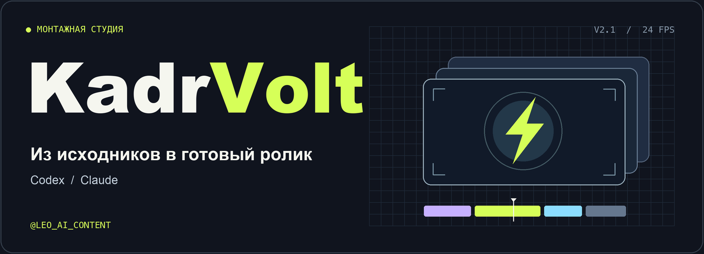
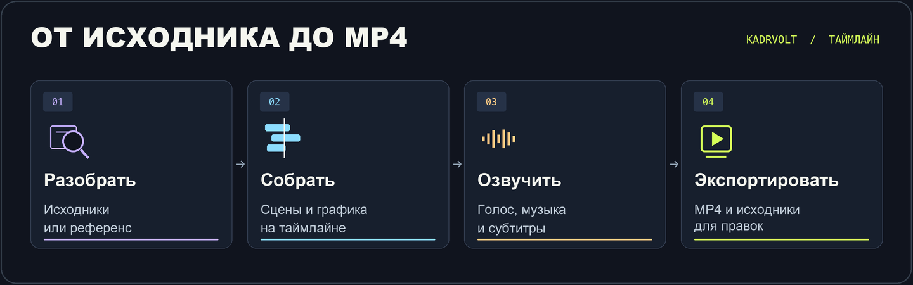
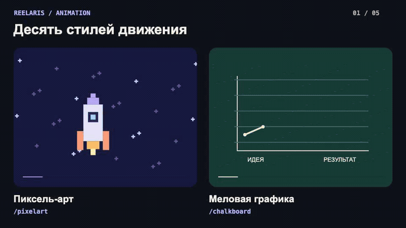
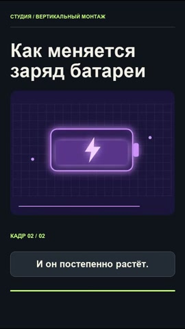
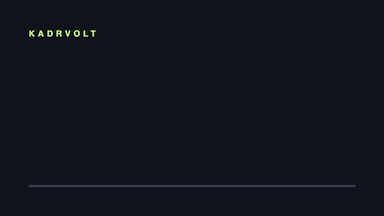
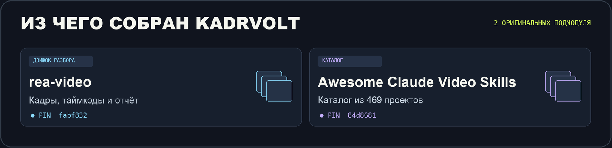

# KadrVolt

**Видеомонтаж от исходника до готового ролика.** Дай KadrVolt идею, видео или референс. Скилл поможет выбрать стиль, соберёт таймлайн, добавит нужный звук и графику и отдаст MP4 вместе с редактируемым проектом. Работает с **Codex** и **Claude Code**. Для **Claude в браузере** есть отдельный путь установки ниже.

[**Скачать KadrVolt**](https://github.com/leoaic0nt3nt/kadrvolt/releases/latest/download/KadrVolt-RU.zip) · [Демо](#демо) · [Установка](#установка) · [Команды](#команды) · [@leo_ai_content](https://t.me/leo_ai_content)

## Как идёт работа



Начни с любого этапа. Можно попросить только разобрать референс или сделать субтитры. Для нового ролика скилл предложит 2–3 подходящих стиля и объяснит, как каждый изменит картинку и темп. [Карта монтажного процесса](kadrvolt/references/WORKFLOWS.md)

## Демо

**Одна батарея, десять способов показать заряд.** Каждая пара меняет форму, фактуру и движение. Демо собрано в HyperFrames.

[](showcase/ten-styles.mp4)

[Смотреть MP4](showcase/ten-styles.mp4) · [Открыть исходник HyperFrames](kadrvolt/templates/hyperframes)

| Монтаж, голос и субтитры | Разбор референса | React-анимация |
| --- | --- | --- |
| [](showcase/edit.mp4) | [](showcase/reverse.md) | [](showcase/remotion.mp4) |
| [MP4](showcase/edit.mp4) · [SRT](showcase/edit.srt) · [Таймлайн](showcase/edit-timeline.json) | [Пример отчёта rea-video](showcase/reverse.md) | [Исходник Remotion](kadrvolt/templates/remotion) |

## Установка

1. Скачай [KadrVolt-RU.zip](https://github.com/leoaic0nt3nt/kadrvolt/releases/latest/download/KadrVolt-RU.zip) и распакуй. В корне лежит эта инструкция.
2. Скопируй **всю папку `kadrvolt`**, внутри которой лежит `SKILL.md`, в каталог нужного ассистента.
3. Открой новый чат и вызови скилл. Если ставил прежнюю версию Codex Animation Studio, убери старую папку из каталога скиллов после установки KadrVolt.

| Где работаешь | Личная установка | Вызов |
| --- | --- | --- |
| Codex | `~/.agents/skills/kadrvolt/` | `$kadrvolt` |
| Claude Code | `~/.claude/skills/kadrvolt/` | `/kadrvolt` |

Для одного проекта положи папку в `.agents/skills/` или `.claude/skills/` внутри проекта. На Windows `~` обозначает домашнюю папку пользователя.

**Claude в браузере.** Скачай [KadrVolt-Claude.zip](https://github.com/leoaic0nt3nt/kadrvolt/releases/latest/download/KadrVolt-Claude.zip) и загрузи его целиком через Customize → Skills → Create skill → Upload a skill. Сначала включи создание файлов и исполнение кода в настройках. В компактном ZIP есть сам скилл, шаблоны, CLI разбора и каталог. Библиотека готовых звуков входит в полный ZIP. Для работы с локальными исходниками и рендера выбирай Codex или Claude Code с доступом к терминалу. [Инструкция Claude](https://support.claude.com/en/articles/12512180-use-skills-in-claude) · [Каталоги скиллов Codex](https://developers.openai.com/api/reference/cli)

### Движки и звук

| Задача | Что нужно |
| --- | --- |
| Нарезка и экспорт MP4 | FFmpeg, FFprobe и Python 3.10+. [Монтаж по JSON](kadrvolt/references/ENGINES.md#ffmpeg) |
| Моушн-дизайн и анимация | Node.js 22+, npm и Chromium. Скопируй [шаблон HyperFrames](kadrvolt/templates/hyperframes) или [Remotion](kadrvolt/templates/remotion) и выполни `npm ci`. [Команды рендера](kadrvolt/references/ENGINES.md) |
| Покадровый разбор | [uv](https://docs.astral.sh/uv/getting-started/installation/) для включённого CLI rea-video. Первый запуск может скачать зависимости и модель обнаружения лиц. [Локальный разбор](kadrvolt/references/REVERSE.md) |
| Синтез речи по желанию | ElevenLabs, Voice ID и ключ в локальной переменной `ELEVENLABS_API_KEY`. Синтез использует лимит аккаунта. Можно приложить готовую запись. [Голос и субтитры](kadrvolt/references/AUDIO.md) |

## Первый ролик

> Используй KadrVolt. У меня есть три исходника и пример того, как хочется смонтировать. Разбери ритм референса, предложи стиль графики и собери вертикальный ролик. Сохрани мою речь, добавь русские субтитры и отдай MP4, SRT и таймлайн.

> KadrVolt /create. Сделай короткий эксплейнер о том, как работает батарейка. Покажи три варианта стиля. После выбора собери ролик с озвучкой.

Если хочешь делегировать всё, допиши «выбери стиль сам и доведи до MP4».

## Команды

| Селектор | Действие |
| --- | --- |
| `/start`, `/help`, `/styles` | Начать, посмотреть возможности и подобрать стиль |
| `/create`, `/edit` | Сделать ролик с нуля или смонтировать исходники |
| `/reverse`, `/remake` | Разобрать референс или применить его приёмы |
| `/voice`, `/captions` | Подготовить голос, расшифровку и субтитры |
| `/preview`, `/export` | Проверить черновик или выгрузить финал |
| `/tools` | Проверить движки и подобрать дополнение |

Укажи стиль прямо в сообщении, например `/create /pixelart`. Ещё доступны `/chalkboard`, `/glowsketch`, `/ps2`, `/comicart`, `/flatvector`, `/dankoe`, `/cgimotion`, `/legostyle` и `/zackdfilms`. [Полное меню с описаниями стилей](kadrvolt/references/COMMANDS.md)

## Оригинальные репозитории



В GitHub-репозитории оба проекта подключены как **Git-подмодули**. Каждый указывает на конкретный оригинальный коммит со всеми файлами и исходной структурой. Полная копия получается при рекурсивном клонировании.

| Подмодуль | Закреплённый коммит | Что делает в KadrVolt |
| --- | --- | --- |
| [`upstream/rea-video`](https://github.com/JuneYaooo/rea-video/tree/fabf832d6b136672be4ed9bff1739d0e6d6788af) | `fabf832` | Даёт CLI для покадрового анализа, таймкодов, отчёта и контактного листа. |
| [`upstream/awesome-claude-video-skills`](https://github.com/zhuyansen/awesome-claude-video-skills/tree/84d86811a655d7eba91115e669c97fcd4e068d55) | `84d8681` | Даёт каталог из 469 проектов. У каждого расширения свой способ установки. |

```sh
git clone --recurse-submodules https://github.com/leoaic0nt3nt/kadrvolt.git
cd kadrvolt
git submodule status
```

В **установочном ZIP** уже лежат рабочий Python-пакет rea-video, индекс ссылок и два выбранных монтажных модуля с лицензиями. Полные деревья с авторскими демо скачиваются из оригинальных репозиториев через подмодули. [Состав пакета и источники](kadrvolt/vendor/SOURCES.md)

На macOS проверены рендеры HyperFrames и Remotion, монтаж со звуком и разбор rea-video. Голос демо синтезирован через [eSpeak NG](https://github.com/espeak-ng/espeak-ng). Подключение ElevenLabs проверено на имитации API.

---

**Лео Бакерин** · [AI для жизни и бизнеса](https://t.me/leo_ai_content)
