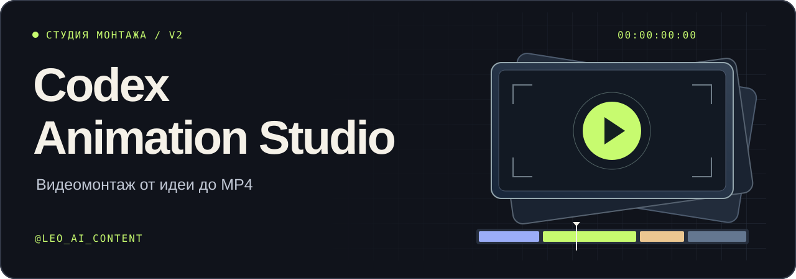
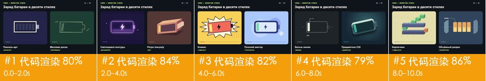

# Codex Animation Studio

Русскоязычный скилл видеомонтажа для Codex и Claude Code. Дай ему идею, свои исходники или ролик-референс. Студия поможет выбрать подход, соберёт таймлайн, предложит озвучку и субтитры, проверит экспорт и отдаст MP4 с редактируемым проектом.

[**Скачать ZIP**](https://github.com/leoaic0nt3nt/codex-animation-studio/releases/latest/download/Codex-Animation-Studio-RU.zip) · [Демо](#демо) · [Установка](#установка) · [Команды](#команды) · [@leo_ai_content](https://t.me/leo_ai_content)

| 15 рабочих сценариев | 10 визуальных стилей | 469 ссылок на расширения |
| --- | --- | --- |
| От первого брифа до проверенного файла | От пиксель-арта до объёмной реконструкции | HyperFrames, Remotion, монтаж, аватары и другие инструменты |

## Демо

**Одна батарея, десять способов показать заряд.** Ролик отрендерен через HyperFrames. В каждой паре меняются геометрия, фактура и характер движения.

[MP4 со всеми стилями](showcase/ten-styles.mp4) · [Исходник HyperFrames](codex-animation-studio/templates/hyperframes)

| Монтаж, голос и субтитры | Разбор референса | React-анимация |
| --- | --- | --- |
|  |  |  |
| [MP4](showcase/edit.mp4) · [SRT](showcase/edit.srt) · [Таймлайн](showcase/edit-timeline.json) | [Пример отчёта rea-video](showcase/reverse.md) | [Исходник Remotion](codex-animation-studio/templates/remotion) |

## Установка

1. Скачай [архив из релиза](https://github.com/leoaic0nt3nt/codex-animation-studio/releases/latest/download/Codex-Animation-Studio-RU.zip) и распакуй. Эта страница лежит в корне архива как `README.md`.
2. Скопируй **всю внутреннюю папку** `codex-animation-studio`, внутри которой лежит `SKILL.md`, в каталог скиллов. В соседних папках архива лежит витрина.
3. Открой новый чат в Codex или Claude Code. В Codex введи `$codex-animation-studio` или выбери студию в списке скиллов. В Claude Code напиши «Используй Codex Animation Studio» или вызови установленный скилл по имени.

| Приложение | Для всех проектов | Для одного проекта |
| --- | --- | --- |
| Codex | `~/.agents/skills/` | `.agents/skills/` |
| Claude Code | `~/.claude/skills/` | `.claude/skills/` |

На Windows `~` — папка пользователя. Создай каталог скиллов, если его ещё нет. При обновлении сделай резервную копию предыдущей версии и замени папку целиком. Папка должна получиться такой: `~/.agents/skills/codex-animation-studio/SKILL.md`.

Для Claude в браузере упакуй только папку `codex-animation-studio` в отдельный ZIP. Включи создание файлов и исполнение кода в настройках, затем открой Customize → Skills → Create skill → Upload a skill. Работа с локальными исходниками, Node.js и FFmpeg проверялась в терминале. [Установка в Claude](https://support.claude.com/en/articles/12512180-use-skills-in-claude) · [Каталоги скиллов Codex](https://developers.openai.com/api/reference/cli)

### Что поставить для рендера

- **Монтаж и экспорт.** `ffmpeg` и `ffprobe` в PATH, Python 3.10+. Проверь команды `ffmpeg -version`, `ffprobe -version` и `python3 --version`. В Windows обычно используется `python` или `py -3`.
- **Анимация.** Node.js 22+, npm и Chromium. В копии шаблона запусти `npm ci`. Для HyperFrames выполни `npx --yes hyperframes@0.9.26 render . --fps 24 --output demo.mp4`. Для Remotion выполни `npm run render`. [Проверки и команды движков](codex-animation-studio/references/ENGINES.md)
- **Разбор референса.** Установи [uv](https://docs.astral.sh/uv/getting-started/installation/). Студия запустит включённый rea-video через `uvx`. Первый запуск может загрузить зависимости и модель обнаружения лиц. [Локальный разбор](codex-animation-studio/references/REVERSE.md)
- **ElevenLabs по желанию.** Выбери голос в аккаунте, возьми его Voice ID и сохрани API-ключ в переменной `ELEVENLABS_API_KEY` в среде, где запускается агент. Скилл поможет подготовить текст, сделать пробу, проверить речь и выставить тайминги. Синтез использует лимит аккаунта. [Подключение ElevenLabs](codex-animation-studio/references/AUDIO.md)

## Первый ролик

Вставь запрос в чат и приложи материалы, если они есть:

> Используй Codex Animation Studio. Помоги сделать вертикальный ролик о том, как работает батарейка. Предложи три подходящих стиля, объясни разницу, потом сделай раскадровку. После выбора стиля собери ролик с озвучкой и русскими субтитрами.

> Используй Codex Animation Studio /edit. Из приложенных видео сделай Reels 9:16. Сохрани мою речь, добавь B-roll и субтитры. Покажи черновик, затем отдай MP4, SRT и редактируемый таймлайн.

> Используй Codex Animation Studio /reverse. Разбери этот референс по таймкодам. Дай таблицу кадров, слоёв и звуковых акцентов. Потом используй эти приёмы в монтаже с моими исходниками.

Если уже знаешь стиль, укажи его сразу, например `/create /pixelart`. Если хочешь делегировать весь процесс, напиши «выбери стиль сам и доведи до готового MP4».

## Команды

| Селектор в сообщении | Действие |
| --- | --- |
| `/start` или `/help` | Показать возможности и выбрать первый шаг |
| `/styles` | Сравнить стили и подобрать вариант под сценарий |
| `/create` | Сделать ролик с нуля |
| `/edit` | Смонтировать исходники или продолжить проект |
| `/reverse` / `/remake` | Разобрать референс / применить его приёмы |
| `/voice` / `/captions` | Подготовить озвучку / расшифровку и субтитры |
| `/preview` / `/export` | Показать черновик / проверить и экспортировать финал |
| `/tools` | Проверить движки и подобрать дополнение |

Селекторы можно писать в обычном сообщении вместе со сценарием. Подробности в [меню скилла](codex-animation-studio/references/COMMANDS.md) и [15 рабочих сценариях](codex-animation-studio/references/WORKFLOWS.md).

| Стиль | Когда подходит |
| --- | --- |
| `/pixelart` | Игровой ретро-образ, чёткие пиксели |
| `/chalkboard` | Объяснение через рисование мелом |
| `/glowsketch` | Энергия, сети и светящиеся схемы |
| `/ps2` | Ретро-игры, низкополигональные объекты |
| `/comicart` | Сюжет через панели и контрастную тушь |
| `/flatvector` | Простые процессы, инфографика, интерфейсы |
| `/dankoe` | Белые линии и минималистичные метафоры |
| `/cgimotion` | Предметная анимация, материалы, свет |
| `/legostyle` | Сборка из игрушечных кирпичиков |
| `/zackdfilms` | Объёмная реконструкция и разрез механизма |

## Что внутри

- **Студия.** Один вход `SKILL.md`, русские сценарии и десять файлов стилей из оригинального пакета. Шаблоны HyperFrames и Remotion, покадровый HTML-рендер, локальная нарезка по JSON, сценарий ElevenLabs и проверка выдачи.
- **rea-video.** Включены исходный CLI, Apache-2.0 и оригинальные руководства. Разбор выдаёт таймкоды, контактный лист и отчёт. Студия добавляет русское резюме. [Исходный проект](https://github.com/JuneYaooo/rea-video)
- **Awesome Claude Video Skills.** Полный снимок ссылок, поиск по категориям и два включённых MIT-модуля по монтажу. Остальные проекты можно выбирать из каталога и подключать отдельно. [Оригинальная подборка и превью авторов](https://github.com/zhuyansen/awesome-claude-video-skills)

Проверено на macOS: HyperFrames, Remotion, покадровый HTML-экспорт, монтаж со звуком и покадровый разбор rea-video. Голос вертикального примера синтезирован локально через [eSpeak NG](https://github.com/espeak-ng/espeak-ng). Для ElevenLabs проверена логика подключения без расходования кредитов. [Источники и условия](codex-animation-studio/vendor/SOURCES.md)

---

**Лео Бакерин** · [AI для жизни и бизнеса](https://t.me/leo_ai_content)
